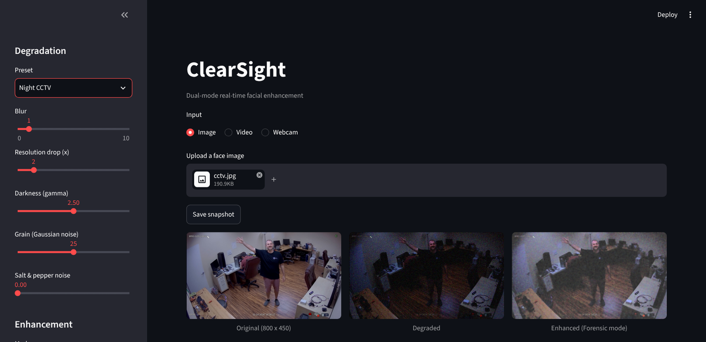
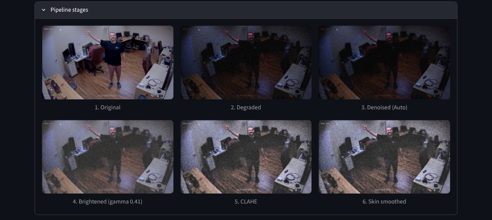
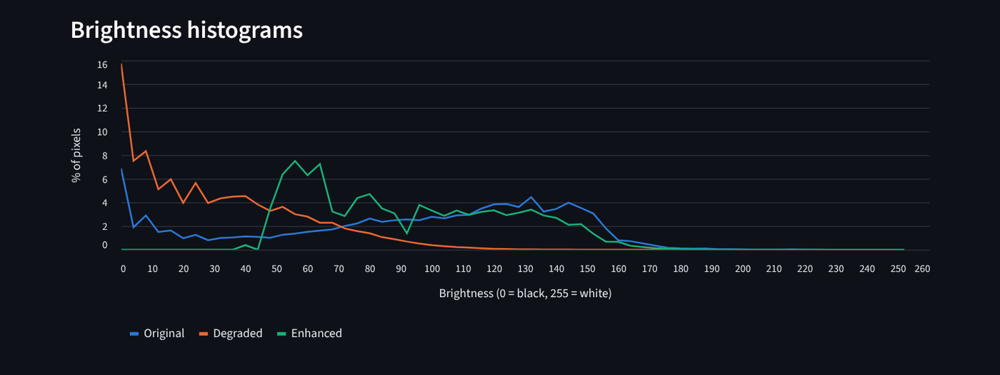
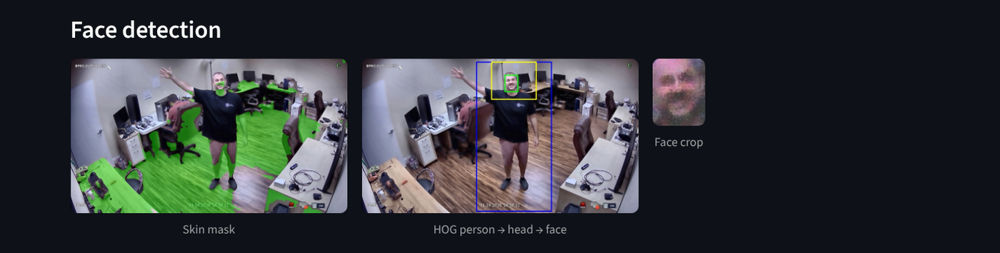
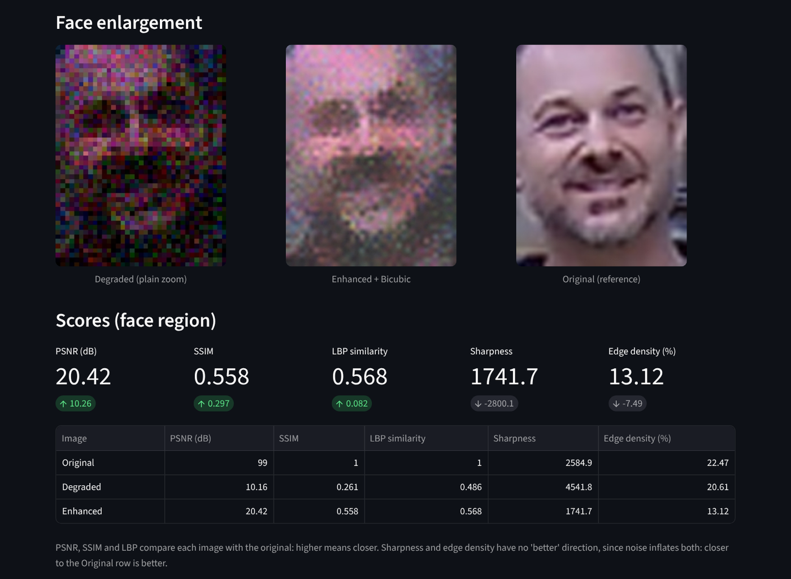
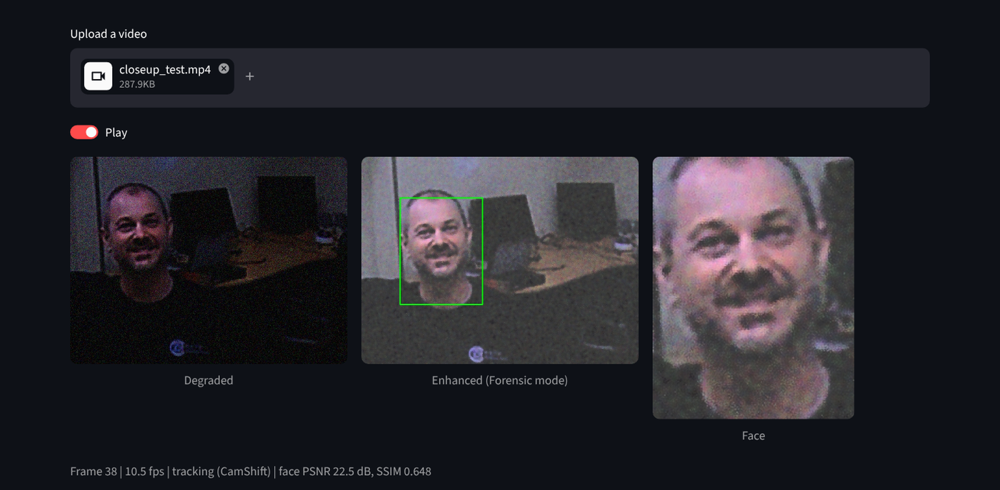

# ClearSight

**Dual-mode real-time facial enhancement**

ClearSight takes a poor-quality image, video or webcam feed (dark, blurry, grainy, low-resolution, faulty pixels), finds the face, and enhances it in one of two modes:

- **Forensic** - maximum fidelity to the truth. Removes noise and fixes brightness, but never smooths, sharpens or invents detail.
- **Beauty** - maximum visual appeal. Adds contrast enhancement and skin smoothing, while keeping eyes, lips and hair sharp.

Every image-processing step uses OpenCV techniques from the course lab manual (or close variations of them). The interface is built with Streamlit.

## Features

- **Three inputs:** image upload, video upload, or live webcam (with a camera picker)
- **Degradation simulator:** blur, resolution drop, darkness, grain and salt & pepper noise, with presets (Night CCTV, Distant camera, Old webcam, Faulty sensor, Worst case) - damages a clean image in a controlled way so the enhancement can be measured against the original
- **Enhancement pipeline:** noise removal -> brightness -> contrast -> sharpening -> skin smoothing, every step adjustable
- **Auto denoise:** detects whether the noise is salt & pepper or grain and picks the right filter
- **Face detection:** HOG person detection + skin-colour segmentation, with a close-up fallback
- **Face tracking in video:** CamShift, with periodic re-detection
- **Face enlargement:** nearest / bilinear / bicubic interpolation, optional progressive 2x steps
- **Scores:** PSNR, SSIM, LBP texture similarity, sharpness and edge density on the face region
- **Pipeline stage viewer, brightness histograms, and one-click snapshots** (all stages + scores + settings saved to `outputs/`)

PSNR and SSIM are evaluation metrics beyond the lab scope. SSIM is implemented with `GaussianBlur` instead of an extra library.

## Screenshots

Main view: a CCTV frame with the Night CCTV degradation preset, enhanced in Forensic mode.



Pipeline stages (Beauty mode): every processing step, in order.



Brightness histograms: the degraded image is crushed into the dark end; enhancement spreads it back out.



Face detection: skin mask (left) and HOG person -> head region -> face (right).



Face enlargement and scores: plain zoom of the degraded face vs the enhanced face vs the original, with PSNR / SSIM / LBP improvements.



Video mode: a night-degraded clip, enhanced live, with the face tracked by CamShift.



## Results

Face-region scores against the clean original, averaged over 5 degradation presets on two test images (`samples/`):

| | PSNR (dB) | SSIM | LBP similarity |
|---|---|---|---|
| Degraded (no fix) | 15.3 | 0.36 | 0.43 |
| Forensic | **21.8** | **0.66** | 0.66 |
| Beauty | 18.3 | 0.65 | **0.69** |

Findings from tuning:
- Sharpening and CLAHE make an image *look* crisper but lower its fidelity scores, so Forensic mode uses neither.
- Median filtering is best for salt & pepper noise and bilateral filtering for grain; no single filter handles both, hence Auto denoise.
- On low-resolution faces there is little fine texture to lose, so Beauty's smoothing slightly *raises* LBP similarity by removing noise.

## Limitations

- Skin segmentation also picks up skin-coloured backgrounds (wooden floors, beige walls).
- HOG needs a full, upright person filling most of the frame; it struggles on heavily degraded images. By default the face is located on the uploaded image so that degradation tests measure enhancement, not detection.
- Interpolation cannot recover detail that was never captured; generative super-resolution (e.g. GANs) was deliberately avoided because invented detail is unacceptable for forensic use.
- In Streamlit, changing a setting restarts the video loop (video resumes from the same frame).

## Project structure

```
ClearSight/
├── app.py               Streamlit interface
├── clearsight/
│   ├── loader.py        image / video / webcam input, snapshots
│   ├── degrade.py       degradation simulator and presets
│   ├── enhance.py       denoising, brightness, contrast, sharpening, skin smoothing
│   ├── segment.py       skin segmentation, HOG, face localisation
│   ├── upscale.py       face enlargement
│   ├── tracker.py       CamShift face tracker
│   ├── metrics.py       PSNR, SSIM, LBP, sharpness, edges, histograms
│   └── pipeline.py      Forensic / Beauty modes and the full pipeline
├── samples/             test image and videos
├── docs/screenshots/    README screenshots
└── requirements.txt
```

## Setup and running

Requires Python 3.10 or newer.

```
git clone https://github.com/OmegaFuryBoi/ClearSight.git
cd ClearSight
python -m venv .venv
.venv\Scripts\activate          # Windows  (macOS / Linux: source .venv/bin/activate)
pip install -r requirements.txt
streamlit run app.py
```

Note: `opencv-contrib-python` is required (not `opencv-python`), because the HOG detector lives in the contrib package in OpenCV 5. Don't install both.

## Author

Darsh Pathak
